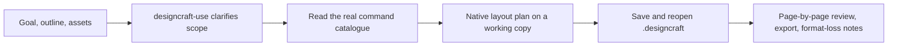

# DesignCraft Use

## Plugin marketplaces

This plugin belongs to **AIGC content creation**.

| Category | Marketplace | Purpose |
| --- | --- | --- |
| Full-stack development | [Full Stack Plugins](https://github.com/partme-ai/full-stack-plugins) | Architecture and UI design, code understanding, quality checks, code review, workflow governance, and server operations |
| AIGC content creation | [Full AIGC Plugins](https://github.com/partme-ai/full-aigc-plugins) | Image, video, audio, music, 3D, and multimodal content creation |


> Lay out brochures, catalogs, newsletters, posters and long documents as editable `.designcraft` projects, then export PDF, IDML, EPUB or images after a print preflight.

[](.codex-plugin/plugin.json)
[](#skills)
[](#mcp-tools)
[](LICENSE)

[English](README.md) | [简体中文](README.zh-CN.md) · [Install](#installation) · [Quick start](#quick-start) · [What you can build](#what-you-can-build) · [Skills](#skills) · [Troubleshooting](#troubleshooting)

## Positioning

DesignCraft Use turns content and assets into an editable page-layout project instead of a flattened mockup. It plans pages, runs the pinned native layout CLI through a small command catalogue, keeps text frames, image frames and linked assets addressable, and only calls a delivery done after the project has been saved, reopened in a new session and reviewed page by page.

It is a development candidate: static package checks and CI pass, while native installation, target-platform acceptance, current host discovery and creative acceptance are all still `NOT_RUN` across `support-matrix.json` and `project-status.json`.

| 16 skills | 1 editor server | 4 export formats | macOS arm64 |
|:---:|:---:|:---:|:---:|
| 6 atomic + 10 local | `designcraft-editor` | PDF, IDML, EPUB, images | Only verified platform |

## Status and version

`0.1.0-dev.20261019.1` · development preview · `docs/verification/release-candidate.json` → `releaseStatus: BLOCKED`, `installableDevelopmentCandidate: true`.

## Installation

### Prerequisites

- macOS arm64 for native execution, with Python 3.11 or newer on `PATH`.
- Node.js 24 or newer when you want the embedded editor MCP server.
- A marketplace install is self-contained. A Git checkout has no `ui/dist/`; build it first with `node build.mjs` and `python3 build-source.py` (Rust `wasm32` target and a matching `wasm-bindgen` are required; the build script installs nothing).
- The native CLI is downloaded into the user data directory on first authorized use; no `sudo` and no `PATH` changes.

### Install the plugin

```bash
codex plugin marketplace add full-aigc-plugins/designcraft-plugin
codex plugin add designcraft@full-aigc-plugins-designcraft
```

`docs/verification/release-candidate.json` records `installableDevelopmentCandidate: true` together with `releaseStatus: BLOCKED`; production promotion and all-host UI acceptance are not claimed.

Manifests for Codex (`.codex-plugin/`), Claude Code (`.claude-plugin/`), ZCode (`.zcode-plugin/`) and Kimi (`kimi.plugin.json`) are present, but host discovery for this candidate is recorded as `NOT_RUN`.

## Quick start

```bash
: "${SKILL_DIR:?Set to the directory holding the loaded designcraft-use SKILL.md}"
python3 -I -B "$SKILL_DIR/scripts/cli.py" -- commands
```

Ask for the work you actually want, for example *“Lay out a two-page product brochure from these images and export a print-ready PDF”*. The entry skill clarifies pages, size, assets, output path and revision scope before it plans anything.



Repository self-checks (no native runtime needed):

```bash
python3 -I -B scripts/validate_package.py
python3 -I -B -m unittest discover -s tests
```

## What you can build

| Workflow | Built-in path | Verifiable output |
|:---|:---|:---|
| Multi-page brochure | `designcraft-brochure` → `designcraft-cli-layout` | Reopened project whose page count, text and linked images are checked |
| Catalog with uniform product layout | `designcraft-catalog` | Reopened catalog with consistent product frames and typography |
| Newsletter or multi-column publication | `designcraft-newsletter` | Reopened multi-column document with verified column flow |
| Poster with a clear information hierarchy | `designcraft-poster-layout` | Large-format project and reviewed export |
| Long document with TOC and page numbers | `designcraft-long-document` | Reopened document with sections, TOC and page numbering |
| Print preflight | `designcraft-print-preflight` | Fonts, images, bleed and export checks recorded before delivery |
| Badges from CSV records | `designcraft-data-merge-badges` | Per-record previews and a reopened project with complete fields |
| Edit in the embedded editor | `designcraft-editor` MCP tools | Saved project reopened and inspected in a new session |

## Skills

| Skill | What it does |
|:---|:---|
| `designcraft-use` | Default entry for new documents and page design; clarifies missing input first |
| `designcraft-cli` | Query and run native designcraft commands with real parameters |
| `designcraft-cli-setup` | First install, digest verification, version checks and failure triage |
| `designcraft-cli-document` | One lifecycle action on an existing project: open, save, save-as, reopen |
| `designcraft-cli-layout` | Query and drive text frames, image frames and page layout |
| `designcraft-cli-export` | Export a project to PDF, images, IDML or EPUB |
| `designcraft-brochure` | Multi-page product brochure from asset review to editable delivery |
| `designcraft-catalog` | Product catalog with uniform layout across many records |
| `designcraft-newsletter` | Multi-column newsletters and briefings |
| `designcraft-poster-layout` | Event poster hierarchy and large-format output |
| `designcraft-long-document` | Chapters, table of contents, page numbers and shared styles |
| `designcraft-print-preflight` | Font, image, bleed and export checks before print |
| `designcraft-data-merge-badges` | CSV-driven badges and name cards with per-record previews |
| `designcraft-scenario-playbooks` | Step-by-step playbooks with real parameters for eight layout scenarios |
| `designcraft-editor` | Open the real editor UI in the host and keep one session for all edits |
| `designcraft-harness` | Cross-session task state, UNKNOWN reconciliation and delivery evidence |

## MCP tools

`mcp.json` declares one stdio server, `designcraft-editor`, started as `node ui/bootstrap.mjs` from the plugin root. It opens the bundled engine in the host and proxies the editor tool set.

| Tool | Purpose |
|:---|:---|
| `open_editor` | Open the editor for an absolute `workspace` path |
| `open_browser_editor` | Return an `editorUrl` for a host built-in browser |
| `editor_status` | Report whether the page has attached to this MCP session |
| `open_document` | Open an existing project file |
| `new_document` | Create a document |
| `inspect_document` | Read the document and frame structure |
| `get_story` | Read the text story |
| `execute` | Run an editor command |
| `save_document` | Save the native project |
| `render_page` | Render a page for visual inspection |

Names come from the `designcraft-editor` skill contract. Page-internal bridge calls such as `_editor_attach` and `_editor_poll` are for the panel itself and must not be called by an agent.

## Configuration

| Variable | Purpose |
|:---|:---|
| `CRAFT_WORKSPACE_ROOT` | Workspace root for `node ui/dist/adapter.mjs --serve` when tools are not registered |
| `CRAFT_EDITOR_CACHE_DIR` | Absolute directory for verified editor downloads (default `~/.cache/full-aigc/editors`) |
| `CRAFT_EDITOR_UPDATE=off` | Stay on the bundled editor and skip the update check |

Metadata requests time out after 5 seconds and archive downloads after 45 seconds. A failed download, missing digest, digest mismatch, malformed archive, changed tool schema or corrupt cache falls back to the bundled editor; `editor_status` reports `source`, `version` and the fallback `reason`.

## Architecture and security

- stdio carries agent-to-plugin traffic; a loopback-only HTTP bridge (`127.0.0.1`) carries the editor page and the same-session edit channel. There is no remote MCP endpoint.
- The browser bridge uses a random token plus Host and Origin checks; paths outside the workspace are refused. Manual browser exports land in `craft-exports/` under the workspace with new file names.
- The native CLI, the skill snapshot, host discovery, model routing, native commands, project reopen and visual review are separate gates. A zero exit code proves only that a process finished.
- Asset digests detect drift only; they are not a sandbox, a rollback or a permission boundary. Read [architecture](docs/architecture.md), [editor integration](docs/editor-integration.md) and [scene skills](docs/scene-skills.md).

## Troubleshooting

| Symptom | Action |
|:---|:---|
| `ui/dist/adapter.mjs` missing | Build the editor resources, or install the release bundle that ships `dist/` |
| Editor page never becomes ready | Call `editor_status`; fix page errors before editing. A text result alone does not mean the UI opened |
| First launch hangs or fails | The first run needs network or a verified cache; keep the pinned archive available for offline use |
| Long paths fail on Windows | `git config --global core.longpaths true`, or use the release ZIP |
| Host has no MCP Apps or browser panel | Open the returned `editorUrl` in the host's built-in browser (Codex built-in browser, DSH right Sidebar Browser, Kimi browser panel); only when the host has none, open it externally and record that this is not embedded-UI acceptance |
| Saved result is unknown | Read the receipt and the existing project first; never replay a write that may have landed |

## Upgrade

```bash
codex plugin marketplace upgrade full-aigc-plugins-designcraft
codex plugin add designcraft@full-aigc-plugins-designcraft
```

Updating the plugin does not rewrite `ui/dist/editor` or the existing lock files; the bundled editor version is always kept as a fallback.

## Contributing and support

Behaviour changes start in [OpenSpec](openspec/changes/harden-designcraft-plugin-delivery/proposal.md). Run the package and unit checks above, keep the English and Chinese documents in step, and do not check a task off without real delivery evidence. Issues: <https://github.com/full-aigc-plugins/designcraft-plugin/issues>.

## License

Original repository content is [Apache-2.0](LICENSE). Upstream icon provenance and licenses are recorded in `assets/official-icon-source.json` and the adjacent LICENSE files; the bundled editor keeps its own upstream license and NOTICE.
